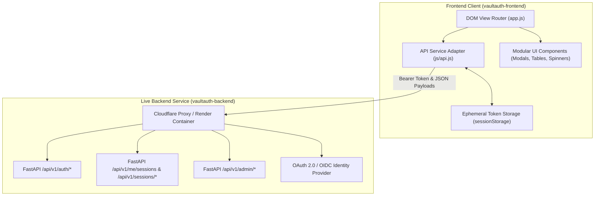
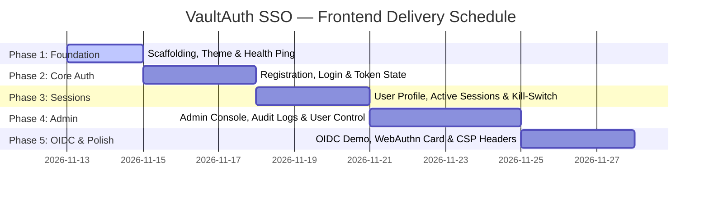

# VaultAuth SSO — Frontend Implementation Planner

## Executive Summary
This planner outlines the step-by-step frontend implementation roadmap for **VaultAuth SSO** (Track: `PST_PD_154`), tailored directly to the live backend API deployed at **`https://api.vaultauth.proplays2312.eu.org/`**.

The frontend is engineered as a modern, high-assurance Single Page Application (SPA) using **Bun**, **React 18**, **Tailwind CSS**, **Lucide Icons**, and an enterprise cybersecurity dark/light design system with Cloudflare-inspired aesthetics.

---

## 1. System Topology & Architecture



---

## 2. Phased Implementation Roadmap



### Phase 1: Foundational Scaffolding & Live Connectivity
- [x] **Repository & Documentation:** Initialized `vaultauth-frontend` with PRD v2.0 and modern stack.
- [x] **Modern Stack Architecture:** Upgraded to Bun runtime, React 18, Vite bundler, and Tailwind CSS.
- [x] **Enterprise Design Tokens:** Custom Cloudflare Tangerine (`#F6821F`) trademark identity, obsidian dark canvas (`#0A0D14`), and pristine light theme (`#F8FAFC`).
- [x] **Tactile Elegant Buttons:** Layered depth, internal highlights, micro-borders, and physical press compression (replacing classic flat buttons).
- [x] **Live Health Handshake:** Dynamic telemetry pill with real-time API ping latency (`GET /health` and `/api/v1/health`).

### Phase 2: Core Authentication & Token Lifecycle
- [x] **Registration Form:** Implements `POST /api/v1/auth/register` with dynamic NIST SP 800-63B password validation (minimum 12 chars, uppercase, lowercase, numbers/symbols).
- [x] **Login Form:** Implements `POST /api/v1/auth/login` with Zero-Trust browser integrity attestation.
- [x] **2FA OTP Challenge Modal:** Implements split 6-digit numeric input with auto-advance, backspace reversing, paste handling, and 10-minute countdown timer (`POST /api/v1/auth/2fa/verify`).
- [x] **Email Verification:** Implements `POST /api/v1/auth/verify-email` and resend throttle (`POST /api/v1/auth/verify-email/resend`).
- [x] **Ephemeral Token Storage:** Stores session token in memory / `sessionStorage` (zero plaintext disk exposure).
- [x] **Uniform Error Handling:** Graceful UI alerts for `ERR_INVALID_CREDENTIALS` (anti-enumeration privacy).
- [x] **Sign Out:** Implements `POST /api/v1/auth/logout`, purges client storage, and resets view state.

### Phase 3: Employee Session Telemetry & Self-Revocation
- [x] **User Profile Card:** Queries `GET /api/v1/me` and renders employee credentials (email, role, created timestamp).
- [x] **Live Active Sessions Table:** Queries `GET /api/v1/me/sessions`, displaying device user-agents, IP addresses, login timestamps, and "Current Device" indicators.
- [x] **1-Click Self-Revocation:** Wires "Revoke" button to `DELETE /api/v1/sessions/{session_id}`.
- [x] **Automatic 401 Interceptor:** If the current session is revoked elsewhere, any API call receiving 401 immediately redirects to login.

### Phase 4: Enterprise Admin Security Console
- [ ] **Role Guarded Navigation:** Evaluates user role; displays "Admin Console" navigation tab exclusively for `role === 'admin'`.
- [ ] **System-Wide Sessions Directory:** Connects to `GET /api/v1/admin/sessions` with 1-click global revocation kill-switch.
- [ ] **User Account Control:** Interfaces with `GET /api/v1/admin/users`, supporting 1-click account unlock (`POST /api/v1/admin/users/{id}/unlock`) and status toggling (`ACTIVE`, `LOCKED`, `DISABLED`).
- [ ] **Immutable Security Audit Log Explorer:** Implements `GET /api/v1/admin/audit-logs` with event-type filtering and XSS-sanitized tabular output.

### Phase 5: OIDC Identity Demo, Stretch Goals & Deployment
- [ ] **WebAuthn / FIDO2 Concept Card:** Interactive modal demonstrating biometric authentication standards.
- [ ] **Render Cold-Start Toast:** UX helper displaying a graceful *"Waking up container..."* alert when backend response latency exceeds 2.0s.
- [ ] **Production Deployment:** Host static build on Vercel with strict Content Security Policy (`vercel.json`).

---

## 3. Component Architecture & File Structure

```text
vaultauth-frontend/
├── index.html                  # Semantic layout with responsive auth & dashboard containers
├── vercel.json                 # Security response headers (CSP, X-Frame-Options, SRI)
├── css/
│   └── style.css               # Cybersecurity dark theme, glowing badges, card layouts
├── js/
│   ├── config.js               # API URL endpoint configuration
│   ├── api.js                  # Asynchronous HTTP client & error handler
│   └── app.js                  # Application entrypoint & DOM event orchestration
└── docs/
    ├── PRD_v2.0.md             # Complete technical requirements specification
    ├── FRONTEND_PLANNER.md     # This implementation roadmap
    └── VaultAuth_SSO_PRD_v2.0.pdf
```

---

## 4. API Integration Contract Mapping

| Frontend Feature | Target Backend Endpoint | Method | Expected HTTP Response |
| :--- | :--- | :---: | :---: |
| **System Health Check** | `/health` | `GET` | `200 {"status": "ok"}` |
| **User Registration** | `/api/v1/auth/register` | `POST` | `201 {"message": "User registered successfully."}` |
| **User Login** | `/api/v1/auth/login` | `POST` | `200 {"token": "...", "user_id": "...", "role": "..."}` |
| **Logout** | `/api/v1/auth/logout` | `POST` | `204 No Content` |
| **Profile Retrieval** | `/api/v1/me` | `GET` | `200 UserProfile` |
| **Active Sessions** | `/api/v1/me/sessions` | `GET` | `200 SessionListResponse` |
| **Revoke Session** | `/api/v1/sessions/{id}` | `DELETE` | `200 SessionRevokeResponse` |
| **Admin All Sessions** | `/api/v1/admin/sessions` | `GET` | `200 AdminSessionListResponse` |
| **Admin Audit Trail** | `/api/v1/admin/audit-logs` | `GET` | `200 AdminAuditLogListResponse` |
| **Admin User Unlock** | `/api/v1/admin/users/{id}/unlock` | `POST` | `200 AdminActionResponse` |

