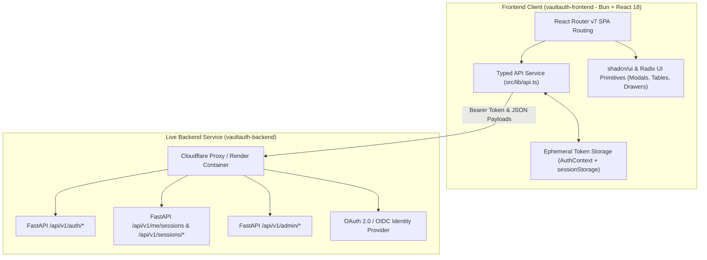
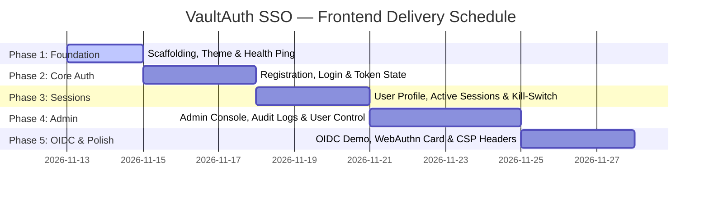

# VaultAuth SSO — Frontend Implementation Planner

## Executive Summary
This planner outlines the step-by-step frontend implementation roadmap for **VaultAuth SSO** (Track: `PST_PD_154`), tailored directly to the live backend API deployed at **`https://api.vaultauth.proplays2312.eu.org/`**.

The frontend is engineered as a modern, high-assurance Single Page Application (SPA) using **Bun**, **React 18**, **Tailwind CSS**, **Lucide Icons**, and an enterprise cybersecurity dark/light design system with Cloudflare-inspired aesthetics.

---

## 1. System Topology & Architecture



---

## 2. Phased Implementation Roadmap



### Phase 1: Foundational Scaffolding & Live Connectivity
- [x] **Repository & Documentation:** Initialized `vaultauth-frontend` with PRD v2.0 and modern stack.
- [x] **Modern Stack Architecture:** Upgraded to Bun runtime, React 18, Vite bundler, and Tailwind CSS.
- [x] **Enterprise Design Tokens:** Custom Cloudflare Tangerine (`#F6821F`) trademark identity, obsidian dark canvas (`#0A0D14`), and pristine light theme (`#F8FAFC`).
- [x] **Tactile Elegant Buttons:** Layered depth, internal highlights, micro-borders, and physical press compression (replacing classic flat buttons).
- [x] **Live Health Handshake:** Dynamic telemetry pill with real-time API ping latency (`GET /health` and `/api/v1/health`).

### Phase 2: Core Authentication & Token Lifecycle
- [x] **Registration Form:** Implements `POST /api/v1/auth/register` with dynamic NIST SP 800-63B password validation (minimum 12 chars, uppercase, lowercase, numbers/symbols).
- [x] **Login Form:** Implements `POST /api/v1/auth/login` with Zero-Trust browser integrity attestation.
- [x] **MFA OTP Challenge Modal:** Implements split 6-digit numeric input with auto-advance, backspace reversing, paste handling, and 10-minute countdown timer (`POST /api/v1/auth/mfa/verify`).
- [x] **Email Verification:** Implements `POST /api/v1/auth/verify-email` and resend throttle (`POST /api/v1/auth/verify-email/resend`).
- [x] **Ephemeral Token Storage:** Stores session token in memory / `sessionStorage` (zero plaintext disk exposure).
- [x] **Uniform Error Handling:** Graceful UI alerts for `ERR_INVALID_CREDENTIALS` (anti-enumeration privacy).
- [x] **Sign Out:** Implements `POST /api/v1/auth/logout`, purges client storage, and resets view state.

### Phase 3: Employee Session Telemetry & Self-Revocation
- [x] **User Profile Card:** Queries `GET /api/v1/me` and renders employee credentials (email, role, created timestamp).
- [x] **Live Active Sessions Table:** Queries `GET /api/v1/me/sessions`, displaying device user-agents, IP addresses, login timestamps, and "Current Device" indicators.
- [x] **1-Click Self-Revocation:** Wires "Revoke" button to `DELETE /api/v1/sessions/{session_id}`.
- [x] **Automatic 401 Interceptor:** If the current session is revoked elsewhere, any API call receiving 401 immediately redirects to login.

### Phase 4: Enterprise Admin Security Console
- [x] **Role Guarded Navigation:** Evaluates user role via `RouteGuards.tsx`; renders "Admin" tabs exclusively for `role === 'admin'`.
- [x] **System-Wide Sessions Directory:** Connects to `GET /api/v1/admin/sessions` with 1-click global revocation kill-switch (`GlobalSessionsTab.tsx`).
- [x] **User Account Control:** Interfaces with `GET /api/v1/admin/users`, supporting 1-click account unlock (`POST /api/v1/admin/users/{id}/unlock`) and status toggling (`ACTIVE`, `LOCKED`, `DISABLED`) (`UsersTab.tsx`).
- [x] **Immutable Security Audit Log Explorer:** Implements `GET /api/v1/admin/audit-logs` with event-type filtering and expandable JSON drawers with XSS sanitization (`AuditLogsTab.tsx`).

### Phase 5: OIDC Identity Demo, Error Pages & Deployment
- [x] **OAuth / OIDC Application Management:** Complete relying party client creation with mandatory **One-Time Secret Reveal Modal** and client revocation (`AppsTab.tsx`).
- [x] **Standardized Error Diagnostics:** Standardized `401`, `403` (Forbidden), `404` (Not Found), `429` (Rate Limited with live reset countdown), `500/503` (Offline), and React `ErrorBoundary`.
- [x] **Render Cold-Start & Latency Defense:** Global non-blocking alert displaying container warm-up status when backend response latency exceeds 2.0s.
- [x] **Production Deployment:** Configured for Vercel with strict Content Security Policy (`vercel.json`) and zero-FOUC theme loader.

---

## 3. Component Architecture & File Structure

```text
vaultauth-frontend/
├── index.html                   # Zero-FOUC theme bootloader & semantic entrypoint
├── package.json                 # Bun/Node package manifest (React 18, Radix UI, Lucide)
├── tsconfig.json                # Strict TypeScript configuration ("strict": true)
├── vite.config.ts               # Vite bundler configuration with @ path aliases
├── tailwind.config.js           # Semantic HSL design tokens & darkMode: ["class"]
├── postcss.config.js            # PostCSS pipeline (Tailwind & Autoprefixer)
├── docs/
│   ├── FRONTEND_PLANNER.md      # Phased delivery roadmap & component spec
│   ├── PRD_v2.0.md              # Product Requirements Document (v2.0)
│   └── VaultAuth_SSO_PRD_v2.0.pdf
└── src/
    ├── main.tsx                 # React DOM root entrypoint
    ├── App.tsx                  # Application route registry with protected guards
    ├── index.css                # Semantic HSL custom properties & theme tokens
    ├── types/
    │   └── api.ts               # Strict TypeScript contracts for all endpoints & errors
    ├── lib/
    │   ├── api.ts               # Typed fetch client, X-Request-ID & X-RateLimit-* parser
    │   └── utils.ts             # cn(), formatters, User-Agent device parser, copyToClipboard
    ├── context/
    │   ├── AuthContext.tsx       # Token persistence, /api/v1/me hydration & role helpers
    │   └── ThemeContext.tsx      # FOUC-free persistent theme state (light | dark | system)
    ├── components/
    │   ├── ui/                  # shadcn-grade primitives
    │   │   ├── button.tsx       # Accessible button with variants (default, outline, destructive, ghost)
    │   │   ├── input.tsx        # High-assurance input with focus rings
    │   │   ├── label.tsx        # Accessible form label
    │   │   ├── card.tsx         # Hairline-bordered card containers
    │   │   ├── badge.tsx        # Semantic status and role badges
    │   │   ├── alert.tsx        # Contextual notification banners
    │   │   ├── table.tsx        # Structured tabular views with uppercase mono headers
    │   │   ├── dialog.tsx       # Radix UI accessible modal dialogs
    │   │   ├── dropdown-menu.tsx# Radix UI popovers and action menus
    │   │   ├── tabs.tsx         # Radix UI accessible segmented tabs
    │   │   ├── separator.tsx    # Crisp 1px hairline dividers
    │   │   ├── collapsible.tsx  # Expandable technical JSON drawers
    │   │   ├── tooltip.tsx      # Hover technical details tooltips
    │   │   ├── otp-input.tsx    # Accessible 6-cell segmented numeric OTP input
    │   │   ├── copy-button.tsx  # 1-click clipboard copy with visual feedback
    │   │   └── ThemeToggle.tsx  # Radix dropdown theme switcher (Light / Dark / System)
    │   └── layout/
    │       ├── AuthShell.tsx    # Constrained layout for authentication views
    │       ├── DashboardShell.tsx# Unified dashboard with role-aware navigation
    │       ├── TopBar.tsx       # Brand mark, live backend telemetry pill & user status
    │       ├── RouteGuards.tsx  # Protected guards (RequireAuth, RequireAdmin, PublicOnly)
    │       └── ErrorLayout.tsx  # Standardized error layout with technical diagnostics
    └── pages/
        ├── auth/
        │   ├── LoginPage.tsx    # /login: Primary credentials with anti-enumeration handling
        │   ├── RegisterPage.tsx # /register: NIST SP 800-63B policy validator (12-128 chars)
        │   └── VerifyOtpPage.tsx# /verify-otp: 6-cell numeric OTP with 60s cooldown & attempt tracking
        ├── dashboard/
        │   ├── ProfileTab.tsx   # /dashboard/profile: User ID, role, status, and crypto specs
        │   ├── SessionsTab.tsx  # /dashboard/sessions: Active employee sessions & 1-click self-revocation
        │   └── admin/
        │       ├── AppsTab.tsx  # /dashboard/admin/apps: OAuth clients + CRITICAL One-Time Secret Reveal
        │       ├── UsersTab.tsx # /dashboard/admin/users: Directory search, 3-strike unlock & status controls
        │       ├── AuditLogsTab.tsx # /dashboard/admin/audit-logs: Security audit trail & JSON drawer
        │       └── GlobalSessionsTab.tsx # /dashboard/admin/sessions: Centralized kill-switch
        └── errors/
            ├── ForbiddenPage.tsx    # 403: ERR_FORBIDDEN (Administrator authority required)
            ├── NotFoundPage.tsx     # 404: ERR_NOT_FOUND (Missing resource or route)
            ├── RateLimitedPage.tsx  # 429: ERR_RATE_LIMITED (Live X-RateLimit-Reset countdown)
            ├── ServerErrorPage.tsx  # 500/503: Offline / gateway unreachable
            └── ErrorBoundary.tsx    # Global React ErrorBoundary wrapping root routes
```

---

## 4. API Integration Contract Mapping

| Frontend Feature | Target Backend Endpoint | Method | Expected HTTP Response |
| :--- | :--- | :---: | :---: |
| **System Health Check** | `/health` | `GET` | `200 {"status": "ok"}` |
| **User Registration** | `/api/v1/auth/register` | `POST` | `201 {"message": "User registered successfully."}` |
| **User Login** | `/api/v1/auth/login` | `POST` | `200 {"token": "...", "user_id": "...", "role": "..."}` |
| **Logout** | `/api/v1/auth/logout` | `POST` | `204 No Content` |
| **Profile Retrieval** | `/api/v1/me` | `GET` | `200 UserProfile` |
| **Active Sessions** | `/api/v1/me/sessions` | `GET` | `200 SessionListResponse` |
| **Revoke Session** | `/api/v1/sessions/{id}` | `DELETE` | `200 SessionRevokeResponse` |
| **Admin All Sessions** | `/api/v1/admin/sessions` | `GET` | `200 AdminSessionListResponse` |
| **Admin Audit Trail** | `/api/v1/admin/audit-logs` | `GET` | `200 AdminAuditLogListResponse` |
| **Admin User Unlock** | `/api/v1/admin/users/{id}/unlock` | `POST` | `200 AdminActionResponse` |

